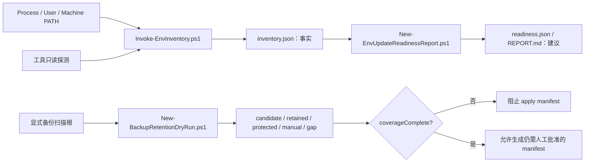

# 环境盘点可信度修复设计

> 状态：已于 2026-07-11 实施并验证完成。本文件保留设计依据；当前主机事实以 `README.md`、`CONTEXT.md` 和 `reports/` 下的最新报告为准。

## 背景

本项目已重新生成本机环境 inventory、更新准备、PATH、项目本地环境和备份保留等只读报告。最新事实表明，当前报告可以证明“脚本运行过”，但还不能可靠支撑后续 PATH 修改、运行时切换或备份清理：

- inventory 只记录当前 Codex 子进程的 PATH，未区分 Process、User、Machine 三个作用域；
- readiness 对部分工具按名称写死建议，导致建议与实际路径相反；
- Python launcher 的文件路径在 D 盘，但实际解释器属于 Hermes 项目本地虚拟环境；
- backup retention 对未识别的 `backups_state` 子目录静默跳过，报告无法证明覆盖完整。

因此，第一批工作只修复盘点和报告的可信度，不恢复旧运行时、不修改 PATH、不删除文件。

## 目标

完成后，项目应能回答以下问题：

1. 当前进程如何解析一个工具，User PATH 和 Machine PATH 的持久原始值及条目分别是什么？
2. 工具入口属于共享运行时、系统/安装器、vendor runtime、项目本地环境，还是未知来源？
3. readiness 的建议和风险是否由实际路径、探测结果及归属共同决定？
4. backup retention 扫描了哪些根、保留了什么、遗漏了什么，覆盖是否完整？
5. 当覆盖不完整时，系统是否能阻止生成可执行清理 manifest？

## 非目标

本变更不做以下事情：

- 不修改 Process、User 或 Machine PATH；
- 不创建、恢复或删除 `D:\Codex\_tools`、.NET、CMake、Ninja、Python 或 Rust 运行时；
- 不切换默认 Python、`UV_PYTHON`、`CARGO_HOME` 或 `RUSTUP_HOME`；
- 不移动、删除或压缩任何备份、缓存、项目本地环境或运行证据；
- 不把历史 README 或旧报告重新声明为当前事实；
- 不自动执行 WinGet、npm、uv、Rustup 或其他管理器命令。

## 设计原则

- **事实与建议分离**：inventory 只记录事实，readiness 才生成建议。
- **作用域显式**：Process、User、Machine PATH 不合并成一个无来源列表。
- **归属优先于盘符**：位于 D 盘不等于共享或低风险；项目 venv、vendor runtime 仍需人工审查。
- **未知项必须可见**：无法分类的路径或备份进入 `unclassified` 或 `manualReview`，不得静默消失。
- **默认拒绝执行**：只读报告继续保持 `readOnly=true`、`executionAllowed=false`；覆盖不完整时禁止生成 apply manifest。
- **可再生**：Markdown 报告只由 JSON 事实和脚本生成，不手工修补快照。

## 方案

### 1. Inventory：拆分 PATH 作用域

`Invoke-EnvInventory.ps1` 新增结构化 `pathScopes`：

```text
pathScopes.process
pathScopes.user
pathScopes.machine
```

每个作用域记录：

- `source`：`process`、`user` 或 `machine`；
- `readStatus`：`ok` 或 `error`；
- `complete`：是否成功取得该 scope 的完整字符串并完成条目分类；
- `errors`：失败时的脱敏错误摘要数组，成功时为空数组；
- `rawValueSha256`：Process 环境或注册表原始 PATH 的哈希，用于检测漂移，不保存冗余拼接字符串；
- 原始 PATH 字符串的非空条目；
- 保持原顺序的 `index`、`path`、`exists`、`drive`；
- `isReparsePoint` 和目标；
- 重复项，仅在同一作用域内计算；
- 缺失项，不推断删除许可；
- `source`，固定为 `process`、`user` 或 `machine`。

Process PATH 从当前进程读取；User 和 Machine PATH 同时使用注册表原始值与 .NET 只读 API 取值，并记录来源。每个条目固定包含 `rawPath`、`expandedPath`、`expansionStatus`、`exists`、`drive` 和 reparse 信息；`exists`、`drive`、reparse 只根据成功展开的 `expandedPath` 计算。展开失败，或注册表原始值与 .NET 读取结果无法解释地不一致时，相应 scope `complete=false`，且不得据此生成缺失入口清理建议。展开值只用于审计，不声称等同于新登录会话。路径比较使用 Windows 大小写不敏感规则，并在比较键中去掉尾部分隔符，但保留原始展示文本。PATH 是本设计唯一逐项记录的环境变量；不得借此扩展为完整环境变量转储。

现有 `pathEntries` 暂时保留为 `pathScopes.process.entries` 的兼容投影，只投影旧字段 `index`、`path`、`exists`、`drive`，避免一次变更破坏现有消费者；报告必须明确标注它是 Process PATH。后续移除兼容字段应另开变更。

工具解析继续以当前进程的 `Get-Command` 为运行事实，同时新增 `resolutionScope="process"`，避免把它误报成持久主机默认入口。User/Machine PATH 只做顺序和存在性盘点，不在本批次模拟 Windows 完整命令解析。

### 2. Inventory：识别工具真实归属

工具记录新增：

- `originClass`：`shared-tool`、`system-installer`、`windows-system`、`user-profile`、`vendor-runtime`、`project-local-env`、`unknown`；
- `launcher`：记录入口路径、`ownerRoot`、位置分类和 reparse 信息；
- `runtime`：记录真实可执行文件、`ownerRoot`、`prefix`、`basePrefix` 和位置分类；
- `originEvidence`：用于解释分类的最小证据；
- `requiresManualReview`：严格由下述优先级决策表得出，不由盘符或工具名默认。

项目本地环境识别采用两层证据，不能只匹配目录名：

1. 解释器证据表明 `sys.prefix` 与 `sys.base_prefix` 不同，或入口位于 `.venv`、`venv`、`venv-*` 等环境目录；
2. 从真实解释器向上做有界祖先查找，命中调用方传入的项目根集合，或命中 `.git`、`pyproject.toml`、`package.json` 等项目标记。

项目根集合允许包含 `D:\Codex\projects` 之外的显式根；本机 Hermes 复现使用 `D:\hermes-data\hermes-agent`，不得通过全盘搜索猜测。祖先查找不得越过盘符根，不递归扫描无关目录。若只能证明“是虚拟环境”但无法确认 owner，则标记 `unknown` 并人工审查，而不是误判为共享环境。

归属和人工审查采用确定性优先级：

| 优先级 | 条件 | `originClass` | 人工审查 |
| --- | --- | --- | --- |
| 1 | launcher、runtime 或任一父路径命中 reparse point | 保留可证明的 origin，否则 `unknown` | 是，高风险 |
| 2 | 真实解释器属于已确认项目本地环境 | `project-local-env` | 是 |
| 3 | 属于 vendor-bundled runtime | `vendor-runtime` | 是 |
| 4 | 属于 Windows、MSI、Store、WinGet 或官方安装器管理根 | `windows-system` 或 `system-installer` | 是 |
| 5 | 位于显式共享工具根 allowlist 且探测成功 | `shared-tool` | 否，但仍禁止自动更新 |
| 6 | 其他或证据不足 | `unknown` | 是 |

`shared-tool` 不能仅凭 D 盘盘符得出。

Python 在现有 `--version` 之外，再执行一个有超时的只读探测。探测只接受 `Get-Command` 解析到的、存在的绝对 `Application` 路径；Alias、Function、脚本或非绝对入口直接标记未知。调用使用隔离参数 `-I -S -c` 并输出严格 JSON，采集：

- `sys.executable`；
- `sys.prefix`；
- `sys.base_prefix`。

若真实解释器位于已识别项目根的 `.venv`、`venv`、`venv-*` 或等价项目本地环境中，则标记为 `project-local-env`。若 launcher 与真实解释器分属不同所有者根，记录两者，不把 launcher 所在盘符当成最终归属。

探测失败、超时或输出不可解析时不猜测，标记 `unknown` 并进入人工审查。报告不得输出凭据、完整环境变量或项目敏感内容。

### 3. Readiness：由事实生成条件策略

`New-EnvUpdateReadinessReport.ps1` 的策略输入改为：

```text
tool name
locationClass
probeSucceeded
originClass
requiresManualReview
```

规则优先级：

1. `project-local-env`、`vendor-runtime` 或 `unknown`：人工审查，中或高风险，不建议作为共享默认入口；
2. 探测失败：先诊断，不能给“当前已健康”的建议；
3. Windows 系统或安装器目录：只建议使用官方机制，不直接搬目录；
4. 明确的 D 盘共享工具根：保持现有策略，后续按工具生态单独审查；
5. 其他路径：人工确认。

工具专属文案只能补充“应使用哪个官方更新入口”，不能覆盖位置和归属事实。例如 Git 可以保留“Git for Windows 安装器”建议，但不能在路径位于 `C:\Program Files` 时写“当前已在 D 盘”。

readiness 输出新增 `decisionInputs`，保存本次建议实际使用的分类字段，便于测试和审计。

### 4. Backup retention：证明覆盖，不再静默跳过

`New-BackupRetentionDryRun.ps1` 调整分类结果：

扫描根由脚本内显式 allowlist 根据经校验的 `CodexRoot`、`DDriveRoot` 派生，写入 `declaredScanRoots`；调用方参数不能增加 allowlist 之外的根。枚举使用 `Get-ChildItem -Force`，同时包含文件和目录。每个直接子项必须有且只有一个互斥的 `coverageDisposition`：

- `candidate`：已识别且超过保留规则；
- `retained`：已识别且仍应保留；
- `protected`：明确保护；
- `delegated-root`：由另一个更窄扫描根负责分类，并记录目标扫描根；
- `gap`：无法识别、枚举不完整或规则返回旧 `__skip__`。

每项另有 `requiresManualReview` 和 `blocksCoverage`。人工审查是处置动作，不参与分类互斥性；`gap`、根/子项 reparse point、不可访问和枚举异常必须 `blocksCoverage=true`。其他 disposition 可以要求人工审查，但只有明确的覆盖阻塞原因才能令 `blocksCoverage=true`。

生产模式固定：

- `artifactMode="production"`；
- `CodexRoot="D:\Codex\.codex"`；
- `DDriveRoot="D:\Codex"`；
- `retainCount=5`；
- `policyId="env-governance.backup-retention"`；
- `policyVersion=2`。

测试可以使用 fixture 根，但产物必须标为 `artifactMode="test"`；apply 无条件拒绝测试模式。生产模式若收到不同根、保留数量或 policy 值，必须失败，不能仅以“仍在 D 盘”为由接受。

新增：

- `evaluatedRoots`：每个计划扫描根的存在性、reparse 状态、直接子项数量及分类计数；
- `coverageAccounted`：所有成功枚举到的直接子项都有且只有一个 disposition，且计数守恒；
- `coverageComplete`：仅当 `coverageAccounted=true`、所有声明根 `enumerationCompleted=true`、没有错误或 `blocksCoverage=true` 项，且每个 `delegated-root` 都指向另一个成功完成的扫描根时为 `true`；
- `coverageNotes`：说明脚本是显式根集合的覆盖证明，不声称扫描全盘；
- `unclassifiedCoverageGaps`：列出未知项的路径、所属扫描根和无法分类原因。

发现仍保持只读且 reparse-safe。名称像备份不构成删除依据；未知项只能进入人工审查。

每个 `evaluatedRoots` 条目记录 `enumerationStarted`、`enumerationCompleted`、`errors`、直接子项规范路径快照、项目类型、reparse 状态、分类计数和快照 SHA-256。覆盖核对使用规范化绝对路径作为身份键。每个直接子项必须恰好进入一个父根分类；`delegated-root` 的目标必须对应另一个实际完成的 `evaluatedRoots` 条目，否则覆盖仍为不完整。

`delegated-root` 的目标必须严格等于当前子项的规范路径、是父扫描根的直接子项，并严格等于另一个 canonical `declaredScanRoots` 条目。委托图必须无自引用、无环，且每个被委托根只有一个父级归属。

### 5. Apply manifest 安全门

`New-BackupRetentionApplyManifest.ps1` 在读取 dry-run JSON 后必须验证：

- `artifactType="env-governance.backup-retention-dry-run"`；
- `coverageComplete=true`；
- `unclassifiedCoverageGaps` 为空；
- 输入 JSON 的 `schemaVersion` 必须严格等于 2，且包含 `evaluatedRoots`、`coverageComplete`、`unclassifiedCoverageGaps` 和互斥 disposition 统计；
- 每个候选仍满足既有 D 盘、路径、reparse point、数量和体积校验。

解析必须严格校验 JSON 原生类型：版本是整数、布尔字段是 boolean、必需集合是数组；不得把字符串 `"false"` 强制转换为真值。还要校验候选规范路径唯一、分类集合互斥、计数守恒、所有路径属于声明根，并保留现有未来时间与 24 小时 freshness gate。

生成 manifest 前重新枚举所有 `declaredScanRoots` 并计算直接子项快照。任何根存在性、枚举完成状态、计数、规范路径、项目类型或 reparse 状态与 dry-run 指纹不一致，均按 TOCTOU 漂移失败。manifest 记录源 dry-run 文件 SHA-256 和根快照指纹；任一条件不满足时不生成 manifest。历史 schema 不能默认为完整覆盖，必须要求重新生成 dry-run。

apply 脚本不能信任输入 JSON 自报的根集合。它必须根据受信任且通过 D 盘/reparse 校验的 `CodexRoot`、`DDriveRoot`，用脚本内同一 allowlist 重新推导允许根集合；输入 `declaredScanRoots` 与重新推导结果必须按规范路径完全相等，缺项、多项或替换任一根都失败。

dry-run 与 apply 必须调用同一份纯分类与保留规则实现，例如只含只读函数的 `scripts/lib/BackupRetentionPolicy.ps1`。apply 在 canonical 生产根上现场重新枚举并在内存中复算每个路径的 `coverageDisposition`、`groupKey`、`backupType`、严格时间戳、`retainRank` 和 `blocksCoverage`，再与 dry-run 逐规范路径比较；候选数组必须与 `coverageDisposition=candidate` 的记录一一对应。任何语义差异均失败，不能只验证输入 JSON 自洽或哈希未变。apply 还必须精确校验固定的 `artifactMode`、根、`retainCount`、`policyId` 和 `policyVersion`。

严格解析、可信根重推导、现场复算和逐路径比较再抽成无写入的纯验证函数，例如 `Test-BackupRetentionDryRunDocument -Document -TrustedPolicyContext`。生产 apply 入口只能构造固定 production context，并在纯验证成功后写 manifest；测试可直接向纯函数注入 fixture context，覆盖深层失败分支，但不能通过正式 apply 入口绕过 `artifactMode="test"` 拒绝门。

所有 JSON 与 Markdown 报告先写入同一 D 盘目标父目录内的 staging 目录，并共享 `generationId`。完成 schema、交叉字段和 Markdown 摘要一致性验证后，对每个目标文件执行单文件原子替换。Markdown 内嵌源 JSON SHA-256；两文件替换不宣称具备事务原子性，消费者和下次生成必须同时校验 `generationId` 与源 JSON 哈希，不一致时拒绝把该对文件视为已发布并重新生成。历史版本由 Git 记录，不创建新的散落备份目录。

## 数据流



## 测试策略

实施必须采用测试先行：每个生产改动前先建立会因现状缺失而失败的测试，并确认失败原因正确。

### Inventory 测试

- Process、User、Machine PATH 分别生成且不串 scope；
- scope 读取失败时 `readStatus=error`、`complete=false`，且不能被解释为空 PATH；
- `%SystemRoot%` 等条目只根据成功展开后的路径计算存在性；展开失败或注册表/.NET 读取不一致时不得生成清理建议；
- 重复项仅在同一 scope 内计算；
- Process 注入路径不会被写成 User/Machine 条目；
- Python launcher 位于项目根集合之外、但真实解释器命中显式 Hermes 项目根时，`launcher` 与 `runtime` owner 分别记录，最终分类为 `project-local-env`；
- Python 探测失败时分类为 `unknown` 且需人工审查；
- 兼容 `pathEntries` 与 process entries 一致。

### Readiness 测试

- Git 位于 `C:\Program Files` 时不得出现“当前已在 D 盘”；
- Cargo/Rust 位于 D 盘共享根时不得出现“系统安装目录”；
- uv 已位于 D 盘时不得建议“迁到 D 盘”；
- 项目本地 Python 不得标为低风险共享运行时；
- `decisionInputs` 与最终动作、风险一致。
- 对所有工具专属分支做表驱动测试，包括 Python、uv、Node、npm、Cargo、Rust、.NET、CMake、Ninja、WSL、Git、pwsh 和 powershell；覆盖各位置类别、origin 类别与探测成功/失败组合。
- 位置陈述只能来自共享的 `locationClass`/`originClass` 决策层；表驱动不变量断言任何工具专属更新入口文案都不能包含与输入位置相反的陈述。

### Backup 测试

- 未知 `backups_state` 子目录进入 `unclassifiedCoverageGaps` 和人工审查；
- 未知项虽然被记录并 `coverageAccounted=true`，但因 `blocksCoverage=true` 必须令 `coverageComplete=false`；
- 保留期内的已识别项出现在 `retainedItems`；
- 嵌套 `provider-sync` 在父根中标为 `delegated-root`，且仅由子根计算一次；
- 委托根自引用、双向环、非直接子项或多父归属均失败关闭；
- 每个扫描根的直接子项分类总数与实际数量相等；
- 存在 gap 时 `coverageComplete=false`；
- `coverageComplete=false` 时 apply manifest 生成失败；
- dry-run 后新增 sibling、修改 reparse 状态或改变根快照时 apply manifest 生成失败；
- dry-run 伪造、缺少或增加 `declaredScanRoots` 时，因与受信任 allowlist 重推导结果不一致而失败；
- 篡改 candidate/retained 语义、保留排名、policy、生产根、`retainCount` 或使用测试模式 artifact 时 apply 失败；
- fixture 直接调用无写入纯验证函数覆盖伪造根、候选语义、排名、TOCTOU 和重复路径；正式 apply 入口另测拒绝 test artifact，并证明只有纯验证成功后才写 manifest；
- 字符串 `"false"`、重复候选、重复路径、未知文件和中途枚举异常均失败关闭；
- reparse point 继续只进入人工审查。

### 回归验证

运行项目 README 中的现有 10 个测试，再增加本变更涉及的专项测试。最后重新生成所有受影响报告，执行：

- JSON schema 与 Markdown 摘要一致性检查；
- JSON 与 Markdown `generationId` 一致性检查；
- `git diff --check`；
- 双子代理对抗性审查，重点攻击归属误判、覆盖假阳性和 apply gate 绕过。

## 迁移与兼容

- inventory schema 从 2 升到 3；旧消费者可继续读取兼容 `pathEntries`；
- readiness schema 从 2 升到 3，记录 inventory schema 版本；
- backup dry-run schema 从 1 升到 2，apply manifest schema 从 1 升到 2；
- 四类 JSON 分别使用 `env-governance.inventory`、`env-governance.update-readiness`、`env-governance.backup-retention-dry-run`、`env-governance.backup-retention-apply-manifest` 作为 `artifactType`；
- readiness 3 只接受 inventory 3，并拒绝缺少 `pathScopes` 或 origin 字段的输入；
- apply manifest 2 只接受 backup dry-run 2；旧版、未来版或缺少必需字段的输入均失败，不做宽松降级；
- 旧 backup dry-run 一律视为覆盖未知，不能生成新 apply manifest；
- 当前已生成但存在已知缺陷的报告，在实现后由脚本覆盖重建，不手工编辑。

## 失败处理

- PATH scope 读取失败：保留其他 scope，记录错误并将相应 scope 标为不完整；
- Python 探测失败或超时：不影响 inventory 生成，但归属为未知并人工审查；
- 扫描根命中 reparse point：该根覆盖不完整，进入人工审查；
- 子项分类失败：进入 gap，`coverageComplete=false`；
- 下游读取不支持的 schema：失败并要求重新生成上游报告。

## 验收标准

1. 报告不再出现与实际位置相反的工具建议。
2. Hermes 项目 venv launcher 不再被识别为低风险共享 Python。
3. Process、User、Machine PATH 在 JSON 和 Markdown 中可分别审计。
4. 所有 `declaredScanRoots` 的每个直接文件和目录在报告中都有明确且互斥的分类。
5. 任一未知备份项都会令 `coverageComplete=false` 并阻止 apply manifest。
6. 所有新增回归测试先红后绿，现有测试和 `git diff --check` 全部通过。
7. 实施完成后仍不修改 PATH、注册表、运行时目录或现有备份内容。

## 后续边界

只有本设计实施并重新生成可信报告后，才讨论第二批真实环境整理。第二批必须按具体对象分别授权，例如 HKCU PATH、HKLM .NET 顺序、默认 Python、Rust toolchain 或某个明确备份 manifest；本设计不预先授权这些动作。
