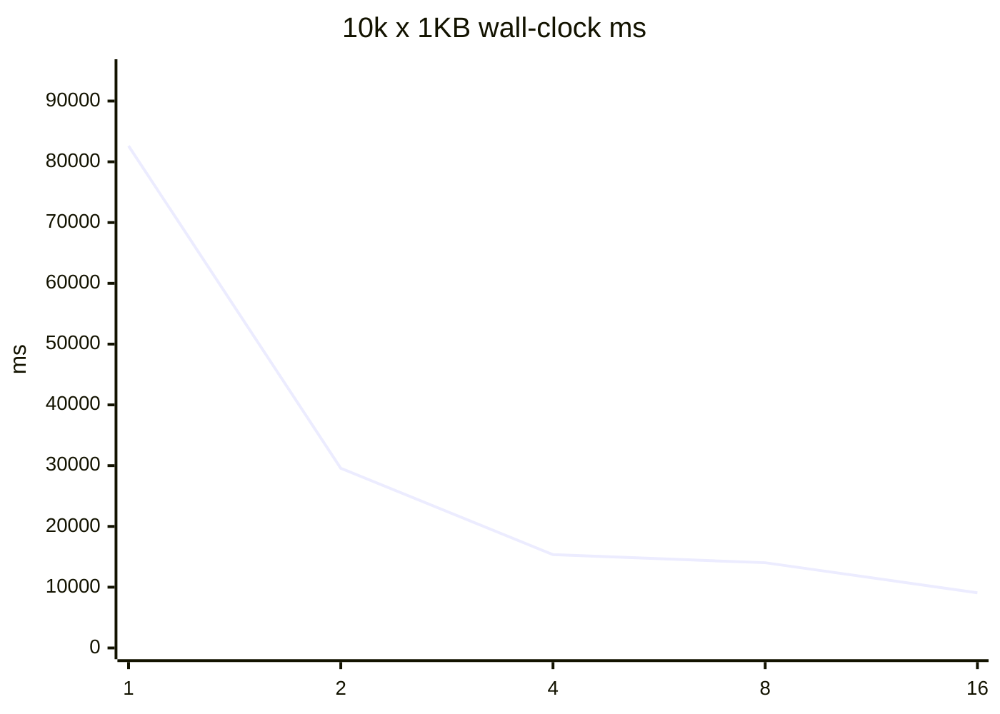
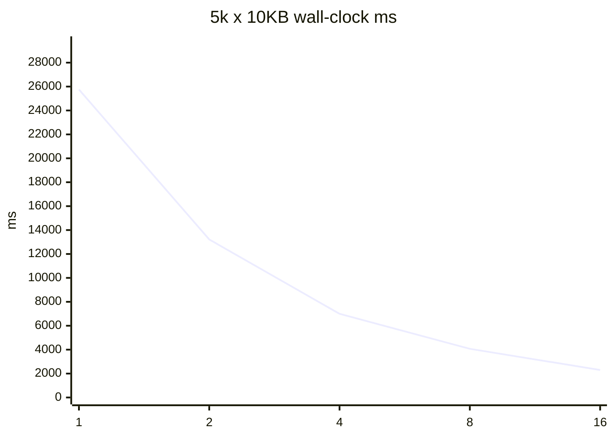
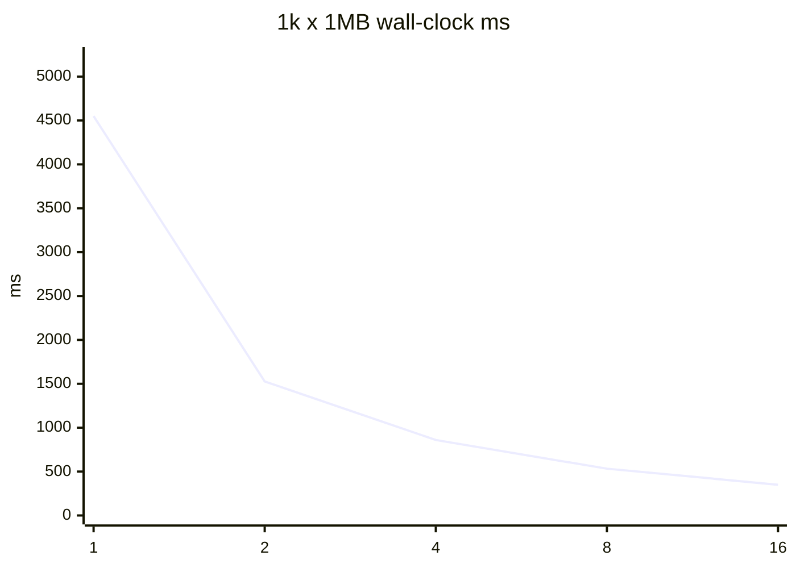

# Safe-tree-delete #40 并行度基准

夹具树只打 `ParallelPurgeCoordinator`，路径限于 `reports/safe-tree-delete-issue40-20260817/`。不是生产 Purge。不是 GitHub 关单授权。

- 测量时间（UTC）：2026-08-17T19:55:45.6544369Z
- ProcessorCount：20
- D: 预检可用：405285769216 bytes
- 顶级目录数：32（目录级并行，供 DOP 16 饱和）
- flush 指标：ParallelPurgeResult.JournalPerformance 汇总 ThreadJournalWriter.TotalFlushTimeMs（#41）

## 收益递减与推荐

决策规则：生产推荐取并行效率（speedup/DOP）峰值。墙钟 10% 膝点与 <10% 增量台阶一并报告；本机 1..16 墙钟未平台。

- 小文件峰值效率 DOP：2；墙钟最佳 / 10%膝点：16 / 16
- 中等峰值效率 DOP：1；墙钟最佳 / 10%膝点：16 / 16
- 大文件峰值效率 DOP：2；墙钟最佳 / 10%膝点：16 / 16
- 票面建议：小 4 / 中 2-4 / 大 1-2；按峰值效率，不支持票面建议。
- `min(4, ProcessorCount-2)` 在本机 = 4。
- 生产 `FromDetection` optimize 取峰值效率 4，不取墙钟 16：1..16 没有墙钟平台，且 flush 线程求和随 DOP 线性上升。

## 10k x 1KB

墙钟最佳 DOP：16（9074 ms）。10%膝点：16。峰值效率 DOP：2（1.397）。
收益递减：在 4 → 8 时增量 0.0868。

| DOP | wall-clock ms | speedup vs 1 | efficiency | CPU ratio | flush% |
| ---: | ---: | ---: | ---: | ---: | ---: |
| 1 | 82617 | 1 | 1 | 0.125 | 9.509 |
| 2 | 29574 | 2.794 | 1.397 | 0.3344 | 26.382 |
| 4 | 15356 | 5.38 | 1.345 | 0.5901 | 52.12 |
| 8 | 14023 | 5.892 | 0.736 | 0.6529 | 368.214 |
| 16 | 9074 | 9.105 | 0.569 | 0.9299 | 753.967 |

## 5k x 10KB

墙钟最佳 DOP：16（2300 ms）。10%膝点：16。峰值效率 DOP：1（1）。
收益递减：在 1→16 范围内没有出现 <10% 的增量台阶（或 DOP1 已是最佳）。

| DOP | wall-clock ms | speedup vs 1 | efficiency | CPU ratio | flush% |
| ---: | ---: | ---: | ---: | ---: | ---: |
| 1 | 25754 | 1 | 1 | 0.2045 | 15.144 |
| 2 | 13217 | 1.949 | 0.974 | 0.357 | 29.439 |
| 4 | 6995 | 3.682 | 0.92 | 0.6813 | 56.677 |
| 8 | 4070 | 6.328 | 0.791 | 0.9713 | 103.833 |
| 16 | 2300 | 11.197 | 0.7 | 1.8139 | 212.652 |

## 1k x 1MB

墙钟最佳 DOP：16（350 ms）。10%膝点：16。峰值效率 DOP：2（1.49）。
收益递减：在 1→16 范围内没有出现 <10% 的增量台阶（或 DOP1 已是最佳）。

| DOP | wall-clock ms | speedup vs 1 | efficiency | CPU ratio | flush% |
| ---: | ---: | ---: | ---: | ---: | ---: |
| 1 | 4550 | 1 | 1 | 0.2541 | 19.802 |
| 2 | 1527 | 2.98 | 1.49 | 0.6549 | 55.73 |
| 4 | 860 | 5.291 | 1.323 | 1.3081 | 110.465 |
| 8 | 533 | 8.537 | 1.067 | 1.7298 | 201.126 |
| 16 | 350 | 13 | 0.812 | 2.7686 | 377.143 |

