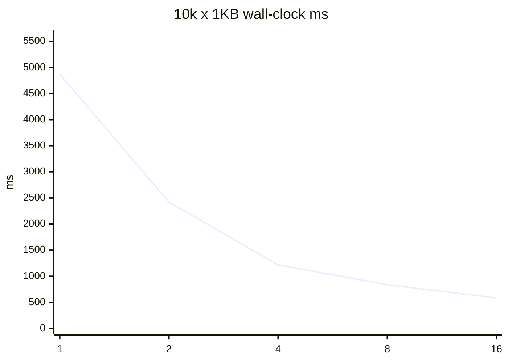
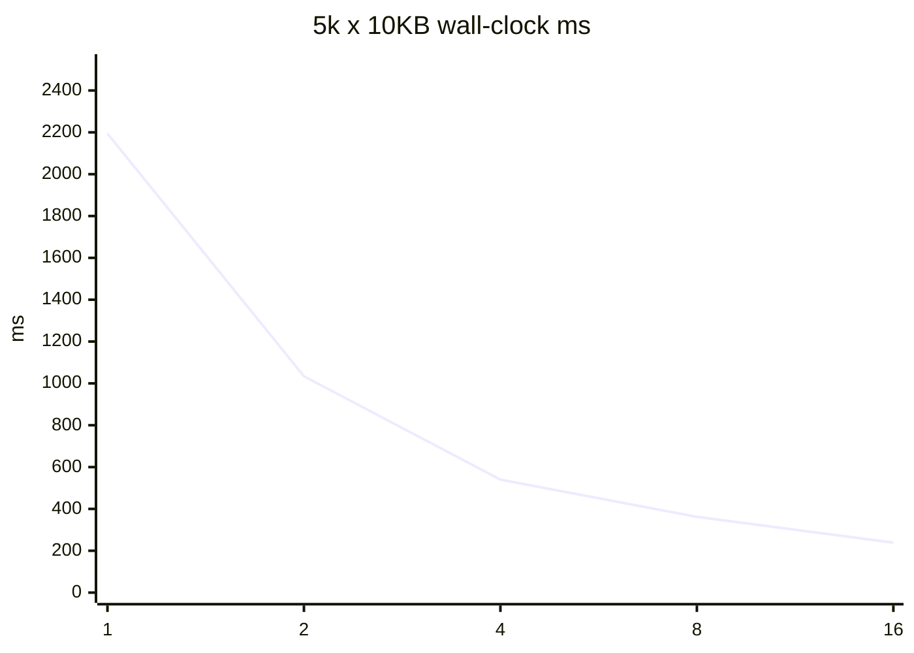

# Safe-tree-delete #40 并行度基准

夹具树只打 `ParallelPurgeCoordinator`，新跑写入 `reports/safe-tree-delete-parallelism-benchmark-20260819/`。不得覆盖 `reports/safe-tree-delete-parallelism-benchmark/` 与 `reports/safe-tree-delete-issue40-20260817/raw/` 历史证据。不是生产 Purge。不是 GitHub 关单授权。

- 测量时间（UTC）：2026-08-19T02:19:27.8709732Z
- ProcessorCount：20
- D: 预检可用：396116893696 bytes
- 顶级目录数：32（目录级并行，供 DOP 16 饱和）
- 每组取样次数：2（全部落盘，算术平均后画曲线）
- flush 指标：ParallelPurgeResult.JournalPerformance 汇总 ThreadJournalWriter.TotalFlushTimeMs（#41）

## 收益递减与推荐

决策规则：生产推荐取各场景并行效率（speedup/DOP）峰值。墙钟 10% 膝点与 <10% 增量台阶一并报告。未知规模的 `FromDetection` 取典型小文件峰值，不取无上界墙钟最小，也不再钉票面 4。

- 小文件峰值效率 DOP：2；墙钟最佳 / 10%膝点：16 / 16
- 中等峰值效率 DOP：2；墙钟最佳 / 10%膝点：16 / 16
- 大文件峰值效率 DOP：2；墙钟最佳 / 10%膝点：16 / 16
- 票面建议：小 4 / 中 2-4 / 大 1-2；按峰值效率，不支持票面建议。
- `min(4, ProcessorCount-2)` 在本机 = 4。
- `FromDetection` optimize 当前值：2；是否对齐本机峰值：True。
- 与票面假设不符 + 数据支撑：票面小文件 4 / min(4, ProcessorCount-2)，本机三场景峰值效率以实测 DOP 为准

## 10k x 1KB

墙钟最佳 DOP：16（585 ms）。10%膝点：16。峰值效率 DOP：2（1.006）。
收益递减：在 1→16 范围内没有出现 <10% 的增量台阶（或 DOP1 已是最佳）。

| DOP | wall-clock ms | speedup vs 1 | efficiency | CPU ratio | flush% |
| ---: | ---: | ---: | ---: | ---: | ---: |
| 1 | 4874 | 1 | 1 | 0.629 | 5.255 |
| 2 | 2421 | 2.013 | 1.006 | 1.103 | 10.401 |
| 4 | 1218 | 4.002 | 1 | 2.289 | 21 |
| 8 | 838 | 5.816 | 0.727 | 3.703 | 132.1 |
| 16 | 585 | 8.332 | 0.521 | 5.343 | 263.658 |

## 5k x 10KB

墙钟最佳 DOP：16（239 ms）。10%膝点：16。峰值效率 DOP：2（1.061）。
收益递减：在 1→16 范围内没有出现 <10% 的增量台阶（或 DOP1 已是最佳）。

| DOP | wall-clock ms | speedup vs 1 | efficiency | CPU ratio | flush% |
| ---: | ---: | ---: | ---: | ---: | ---: |
| 1 | 2194 | 1 | 1 | 0.667 | 5.43 |
| 2 | 1034 | 2.122 | 1.061 | 1.474 | 12.246 |
| 4 | 540 | 4.063 | 1.016 | 2.372 | 21.318 |
| 8 | 362 | 6.061 | 0.758 | 4.732 | 52.704 |
| 16 | 239 | 9.18 | 0.574 | 5.686 | 77.761 |

## 1k x 1MB

墙钟最佳 DOP：16（63 ms）。10%膝点：16。峰值效率 DOP：2（1.17）。
收益递减：在 4 → 8 时增量 0。

| DOP | wall-clock ms | speedup vs 1 | efficiency | CPU ratio | flush% |
| ---: | ---: | ---: | ---: | ---: | ---: |
| 1 | 524 | 1 | 1 | 0.802 | 1.689 |
| 2 | 224 | 2.339 | 1.17 | 1.81 | 5.579 |
| 4 | 160 | 3.275 | 0.819 | 2.459 | 11.797 |
| 8 | 160 | 3.275 | 0.409 | 2.762 | 19.769 |
| 16 | 63 | 8.317 | 0.52 | 7.109 | 81.1 |

