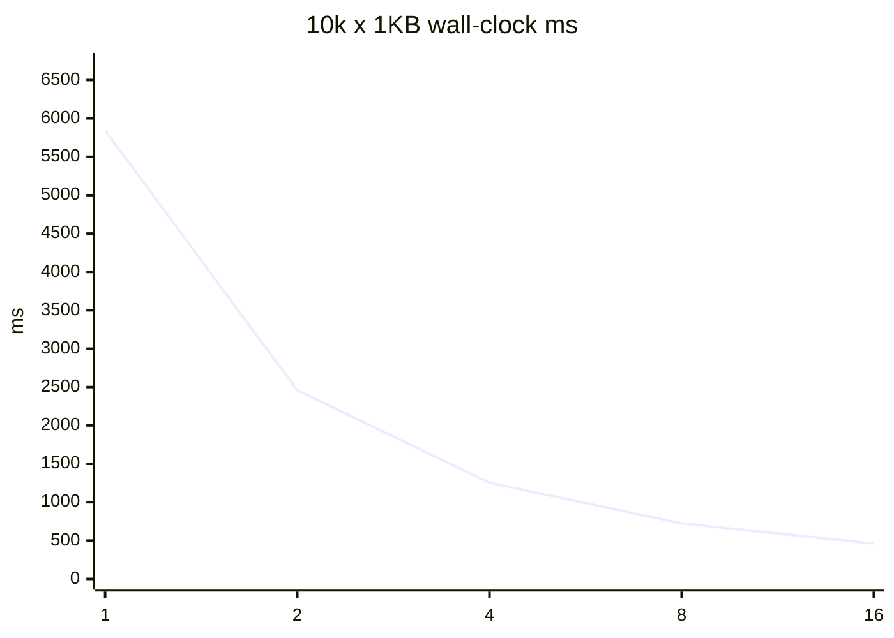
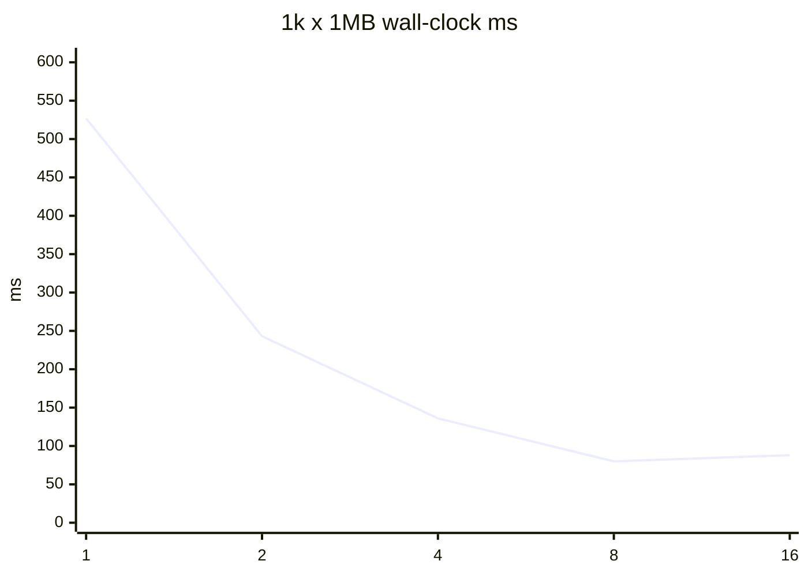

# Safe-tree-delete #40 并行度基准

夹具树只打 `ParallelPurgeCoordinator`，新跑写入 `reports/safe-tree-delete-parallelism-benchmark-20260819/`。不得覆盖 `reports/safe-tree-delete-parallelism-benchmark/` 与 `reports/safe-tree-delete-issue40-20260817/raw/` 历史证据。不是生产 Purge。不是 GitHub 关单授权。

- 测量时间（UTC）：2026-08-23T02:23:00.5928724Z
- ProcessorCount：20
- D: 预检可用：386971426816 bytes
- 顶级目录数：32（目录级并行，供 DOP 16 饱和）
- 每组取样次数：2（全部落盘，算术平均后画曲线）
- flush 指标：ParallelPurgeResult.JournalPerformance 汇总 ThreadJournalWriter.TotalFlushTimeMs（#41）

## 收益递减与推荐

决策规则：生产推荐取各场景并行效率（speedup/DOP）峰值。墙钟 10% 膝点与 <10% 增量台阶一并报告。未知规模的 `FromDetection` 取典型小文件峰值，不取无上界墙钟最小，也不再钉票面 4。

- 小文件峰值效率 DOP：2；墙钟最佳 / 10%膝点：16 / 16
- 中等峰值效率 DOP：2；墙钟最佳 / 10%膝点：16 / 16
- 大文件峰值效率 DOP：2；墙钟最佳 / 10%膝点：8 / 8
- 票面建议：小 4 / 中 2-4 / 大 1-2；按峰值效率，不支持票面建议。
- `min(4, ProcessorCount-2)` 在本机 = 4。
- `FromDetection` optimize 当前值：2；是否对齐本机峰值：True。
- 与票面假设不符 + 数据支撑：票面小文件 4 / min(4, ProcessorCount-2)，本机三场景峰值效率以实测 DOP 为准

## 10k x 1KB

墙钟最佳 DOP：16（462 ms）。10%膝点：16。峰值效率 DOP：2（1.189）。
收益递减：在 1→16 范围内没有出现 <10% 的增量台阶（或 DOP1 已是最佳）。

| DOP | wall-clock ms | speedup vs 1 | efficiency | CPU ratio | flush% |
| ---: | ---: | ---: | ---: | ---: | ---: |
| 1 | 5844 | 1 | 1 | 0.572 | 13.918 |
| 2 | 2458 | 2.378 | 1.189 | 1.043 | 10.419 |
| 4 | 1254 | 4.66 | 1.165 | 2.182 | 24.38 |
| 8 | 724 | 8.072 | 1.009 | 4.054 | 47.652 |
| 16 | 462 | 12.649 | 0.791 | 6.368 | 70.976 |

## 5k x 10KB

墙钟最佳 DOP：16（256 ms）。10%膝点：16。峰值效率 DOP：2（1.018）。
收益递减：在 1→16 范围内没有出现 <10% 的增量台阶（或 DOP1 已是最佳）。

| DOP | wall-clock ms | speedup vs 1 | efficiency | CPU ratio | flush% |
| ---: | ---: | ---: | ---: | ---: | ---: |
| 1 | 2210 | 1 | 1 | 0.704 | 5.383 |
| 2 | 1086 | 2.035 | 1.018 | 1.331 | 11.324 |
| 4 | 570 | 3.877 | 0.969 | 2.344 | 23.766 |
| 8 | 331 | 6.677 | 0.835 | 5.075 | 49.805 |
| 16 | 256 | 8.633 | 0.54 | 6.192 | 79.622 |

## 1k x 1MB

墙钟最佳 DOP：8（80 ms）。10%膝点：8。峰值效率 DOP：2（1.084）。
收益递减：在 8 → 16 时增量 -0.1。

| DOP | wall-clock ms | speedup vs 1 | efficiency | CPU ratio | flush% |
| ---: | ---: | ---: | ---: | ---: | ---: |
| 1 | 527 | 1 | 1 | 0.718 | 2.198 |
| 2 | 243 | 2.169 | 1.084 | 1.704 | 4.525 |
| 4 | 136 | 3.875 | 0.969 | 3.116 | 8.095 |
| 8 | 80 | 6.588 | 0.824 | 4.544 | 41.582 |
| 16 | 88 | 5.989 | 0.374 | 6.003 | 33.15 |

