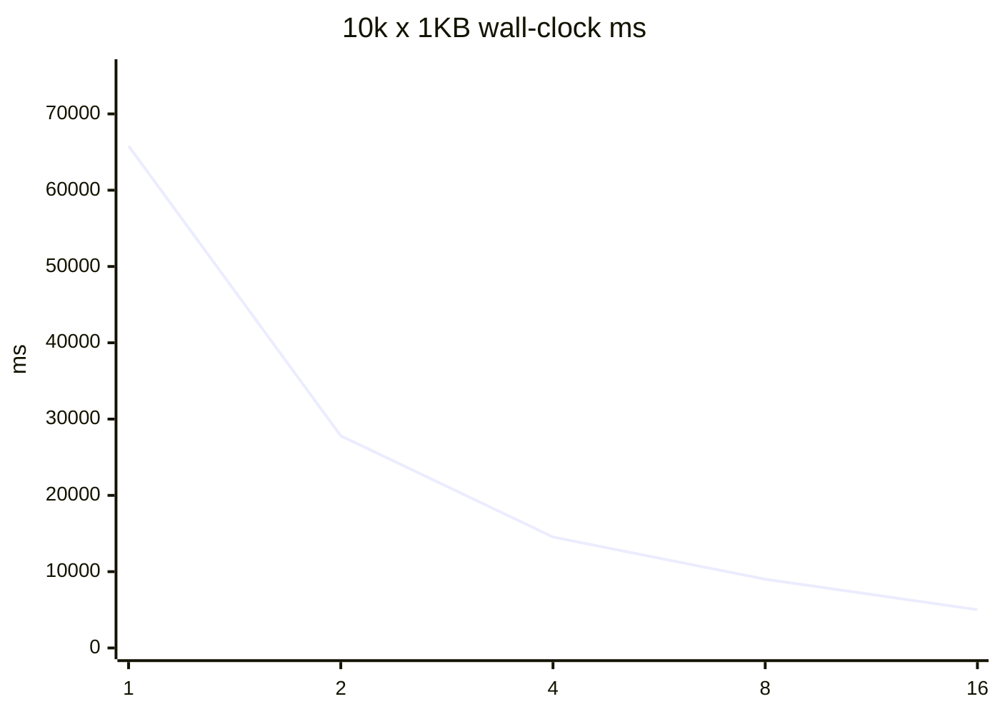
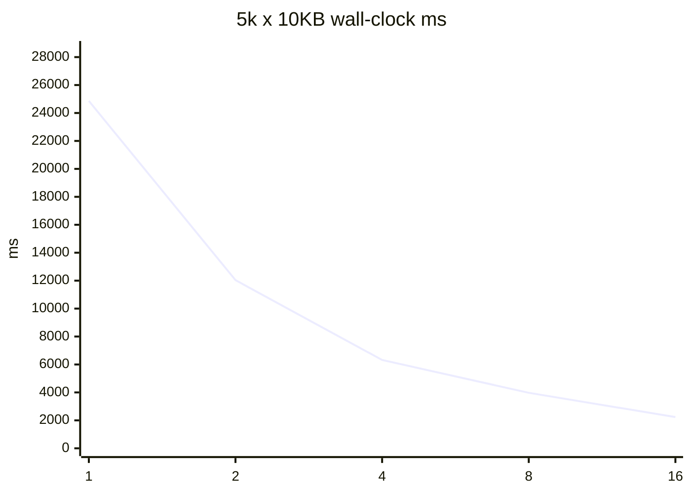
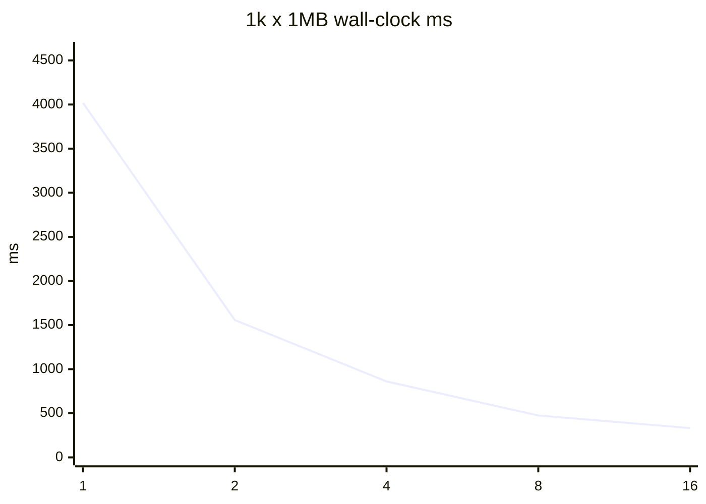

# Safe-tree-delete #40 并行度基准

夹具树只打 `ParallelPurgeCoordinator`，新跑写入 `reports/safe-tree-delete-parallelism-benchmark/`。不得覆盖 `reports/safe-tree-delete-issue40-20260817/raw/` 历史证据。不是生产 Purge。不是 GitHub 关单授权。

- 测量时间（UTC）：2026-08-18T08:04:02.7832705Z
- ProcessorCount：20
- D: 预检可用：397214232576 bytes
- 顶级目录数：32（目录级并行，供 DOP 16 饱和）
- flush 指标：ParallelPurgeResult.JournalPerformance 汇总 ThreadJournalWriter.TotalFlushTimeMs（#41）

## 收益递减与推荐

决策规则：生产推荐取并行效率（speedup/DOP）峰值。墙钟 10% 膝点与 <10% 增量台阶一并报告；本机 1..16 墙钟未平台。

- 小文件峰值效率 DOP：2；墙钟最佳 / 10%膝点：16 / 16
- 中等峰值效率 DOP：2；墙钟最佳 / 10%膝点：16 / 16
- 大文件峰值效率 DOP：2；墙钟最佳 / 10%膝点：16 / 16
- 票面建议：小 4 / 中 2-4 / 大 1-2；按峰值效率，不支持票面建议。
- `min(4, ProcessorCount-2)` 在本机 = 4。
- 生产 `FromDetection` optimize 取峰值效率 4，不取墙钟 16：1..16 没有墙钟平台，且 flush 线程求和随 DOP 线性上升。

## 10k x 1KB

墙钟最佳 DOP：16（5017 ms）。10%膝点：16。峰值效率 DOP：2（1.184）。
收益递减：在 1→16 范围内没有出现 <10% 的增量台阶（或 DOP1 已是最佳）。

| DOP | wall-clock ms | speedup vs 1 | efficiency | CPU ratio | flush% |
| ---: | ---: | ---: | ---: | ---: | ---: |
| 1 | 65807 | 1 | 1 | 0.1448 | 11.218 |
| 2 | 27803 | 2.367 | 1.184 | 0.3063 | 26.915 |
| 4 | 14537 | 4.527 | 1.132 | 0.5546 | 54.224 |
| 8 | 9008 | 7.305 | 0.913 | 0.9696 | 87.31 |
| 16 | 5017 | 13.117 | 0.82 | 1.5292 | 176.659 |

## 5k x 10KB

墙钟最佳 DOP：16（2236 ms）。10%膝点：16。峰值效率 DOP：2（1.032）。
收益递减：在 1→16 范围内没有出现 <10% 的增量台阶（或 DOP1 已是最佳）。

| DOP | wall-clock ms | speedup vs 1 | efficiency | CPU ratio | flush% |
| ---: | ---: | ---: | ---: | ---: | ---: |
| 1 | 24862 | 1 | 1 | 0.181 | 15.092 |
| 2 | 12037 | 2.065 | 1.032 | 0.3375 | 31.004 |
| 4 | 6322 | 3.933 | 0.983 | 0.655 | 61.42 |
| 8 | 3974 | 6.256 | 0.782 | 1.1638 | 103.927 |
| 16 | 2236 | 11.119 | 0.695 | 1.8869 | 207.156 |

## 1k x 1MB

墙钟最佳 DOP：16（332 ms）。10%膝点：16。峰值效率 DOP：2（1.29）。
收益递减：在 1→16 范围内没有出现 <10% 的增量台阶（或 DOP1 已是最佳）。

| DOP | wall-clock ms | speedup vs 1 | efficiency | CPU ratio | flush% |
| ---: | ---: | ---: | ---: | ---: | ---: |
| 1 | 4017 | 1 | 1 | 0.2567 | 20.468 |
| 2 | 1557 | 2.58 | 1.29 | 0.492 | 55.748 |
| 4 | 861 | 4.666 | 1.166 | 1.252 | 126.365 |
| 8 | 475 | 8.457 | 1.057 | 1.6779 | 217.053 |
| 16 | 332 | 12.099 | 0.756 | 2.8705 | 381.873 |

